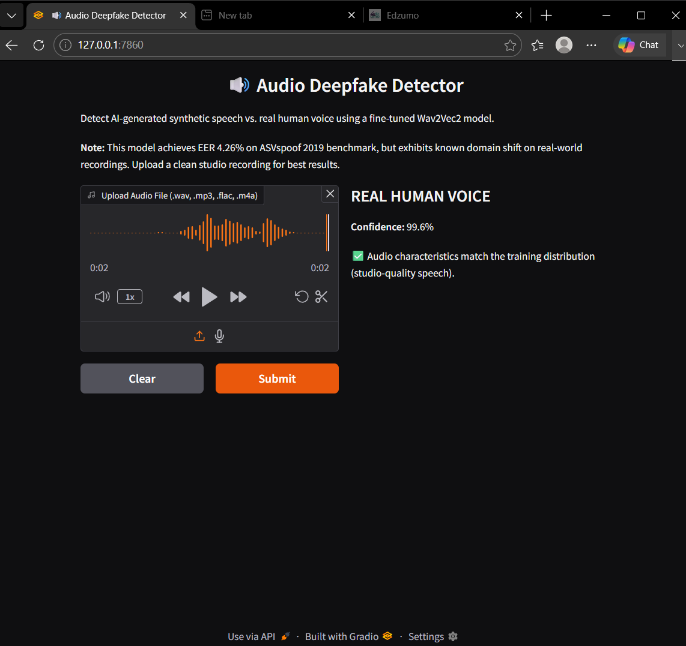

# Audio Deepfake Detector with Cross-Era Generalization Analysis

Fine-tuned Wav2Vec2 classifier for AI-generated speech detection, with explicit stress testing against modern neural TTS and real-world audio to expose domain shift limitations.

## One-Line Pitch

Trained on 2016-era fake voices. Tested on 2026-era fake voices. Discovered it fails on 2026 real voices too — because it learned the studio, not the human.

## Results

| Test Group | Result | Interpretation |
|---|---|---|
| ASVspoof 2019 Eval (Baseline) | EER: 4.26%, Acc: 84.2% | Strong in-distribution performance |
| ASVspoof Real Voices (Control) | 9/10 detected as REAL (99.6% confidence) | Model CAN detect real speech when it matches training domain |
| Edge TTS Neural (Modern Fakes) | 100% detected as fake | Catches modern synthesis |
| Self-Recorded Laptop Voice | 0/10 detected as REAL (99.7% confidence "fake") | **Domain shift:** model learned "ASVspoof studio" vs "not ASVspoof studio" |

## Key Finding

The model correctly identifies studio-recorded real voices as real with near-certainty. However, it classifies real-world laptop recordings as synthetic with equal confidence. This reveals the model learned **dataset-specific artifacts** (studio acoustics, professional microphones) rather than the general concept of **human vs. synthetic speech**.

## Tech Stack

Python, PyTorch, Hugging Face Transformers, Wav2Vec2, Gradio

## Demo



Run locally:
```bash
pip install -r requirements.txt
python app/demo.py